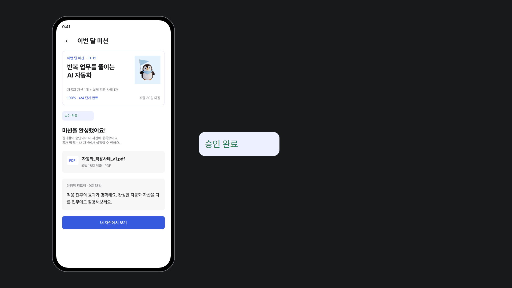
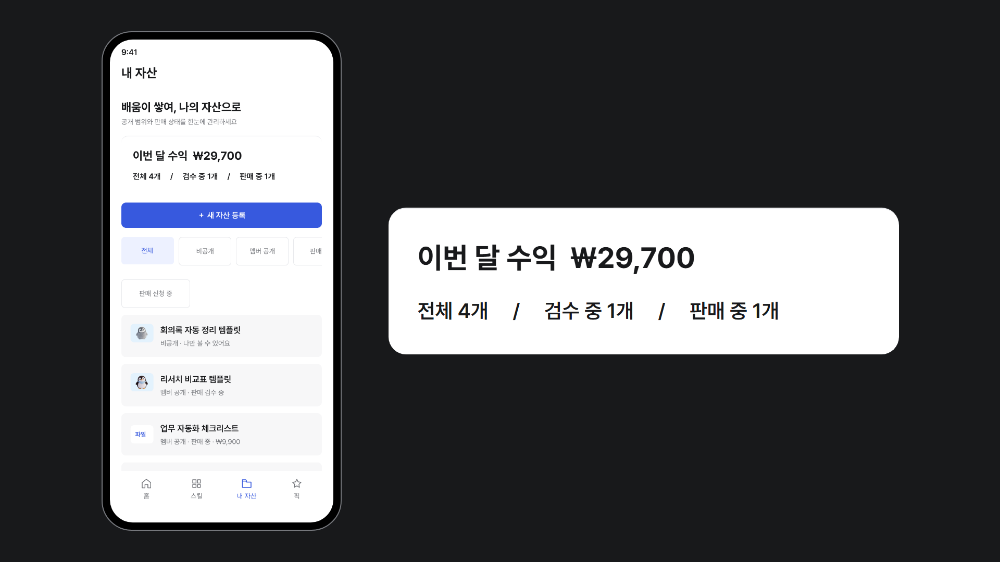
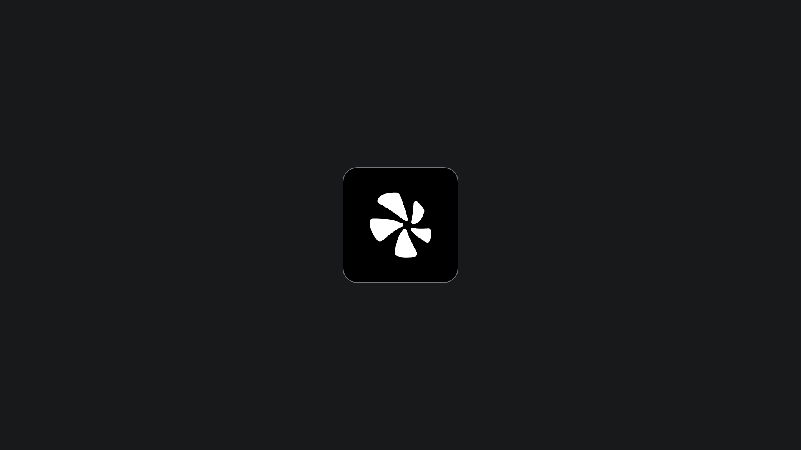

# [사이클5/1차 실험] 트랙A. 모션 하네스 제작

"모션 만들자" 한마디로 요청해도 **영상 룩이 매번 같게** 나오는 작업 틀을 만들었다.

▶ 원본 영상: [`out/app-intro/video.mp4`](out/app-intro/video.mp4) (5초 · 1920×1080 · 30fps)

## 어떻게 만들었나

- **고정**: 색 · 글자 · 움직임 숫자는 `docs/` 세 문서(design · motion · video)에만 둔다. 문서에 없는 값은 쓰지 않고 사람에게 묻는다.
- **역할 4개**: art-director(레퍼런스 정리) → director(장면표 3안) → builder(제작) → critic(판정만, 고치지 않음)
- **승인 2번**: 장면표를 고를 때, 스냅보드(정지 화면)를 볼 때 사람이 승인한다.
- **판정 기준**: docs에 없는 숫자 0개 · 화면에 없는 UI 0개 · 레퍼런스 반영 80% 이상

## 결과: `app-intro`

앱 소개 5초 영상. 미션 → 승인 → 수익 → 브랜드 4장면.

| 장면 1 · 미션 | 장면 2 · 승인 |
|---|---|
|  |  |
| **장면 3 · 수익** | **장면 4 · 브랜드** |
|  |  |

| 단계 | 판정 |
|---|---|
| 스냅보드 | 반영 73.9%로 불합격 → 예외 승인 |
| 영상 | **통과** (docs에 없는 숫자 0 · 화면에 없는 UI 0 · 반영 83.3%) |

## 회고

처음 목표는 단순했다. AI한테 영상을 맡기면 할 때마다 색도 바뀌고 속도도 바뀌는데, 그걸 좀 붙잡아 두고 싶었다. 그래서 "값은 문서에만 둔다"는 규칙 하나로 시작했다.

막상 해 보니 규칙을 정하는 것보다 지키게 만드는 게 더 어려웠다. builder가 폰이랑 카드 사이 간격을 90px로 잡아 왔는데, 그럴듯한 근거까지 달려 있어서 나도 처음엔 그냥 넘어갈 뻔했다. critic이 "이 숫자는 docs에 없다"고 짚어 줘서 알았다. 만드는 쪽과 판정하는 쪽을 나눈 게 이번 실험에서 제일 잘한 결정 같다.

장면표에서는 욕심을 버리는 연습을 했다. 5초에 5화면을 다 넣고 싶었는데, 3안을 나란히 놓고 보니 다 넣으면 아무것도 안 보였다. 미션 → 승인 → 수익, 이 흐름 하나만 남기고 나머지는 뺐다.

아쉬운 건 스냅보드 판정이다. 반영률 73.9%로 떨어졌는데, 뜯어 보니 정지 화면으로는 애초에 판정할 수 없는 움직임 항목이 섞여 있었다. 결국 예외로 승인하고 넘어갔는데, 기준을 만든 내가 기준을 넘긴 셈이라 좀 찜찜했다. 영상 단계에서 83.3%로 통과하긴 했지만, 스냅보드용 기준은 따로 있어야 한다.

또 하나 의외였던 건, 문서를 고정해 두니까 문서 자체의 실수가 드러났다는 점이다. motion.md 안에서 배지 등장 길이가 표와 본문에 서로 다르게 적혀 있었고, 폰 크기도 계산이 안 맞았다. 사람이 볼 땐 대충 넘어가던 것들이 AI가 그대로 따르려고 하니까 걸렸다.

다음엔 문서부터 고치고, 레퍼런스가 있는 영상으로 한 번 더 돌려 볼 생각이다. 같은 BRIEF를 넣었을 때 정말 같은 영상이 나오는지, 그게 이 하네스가 제대로 된 건지 확인하는 진짜 시험일 것 같다.

폴더 구조

| 위치 | 내용 |
|---|---|
| `docs/` | design · motion · video 세 문서 |
| `src/` | 부품(HTML) · 화면 이미지 · 원본 파일 |
| `out/app-intro/` | brief · refs · scenes · verdict · 스냅보드 · 영상 |
| `.claude/agents` | 역할 4개 |
| `.claude/skills/make-video` | 전체 순서와 승인 지점 |

